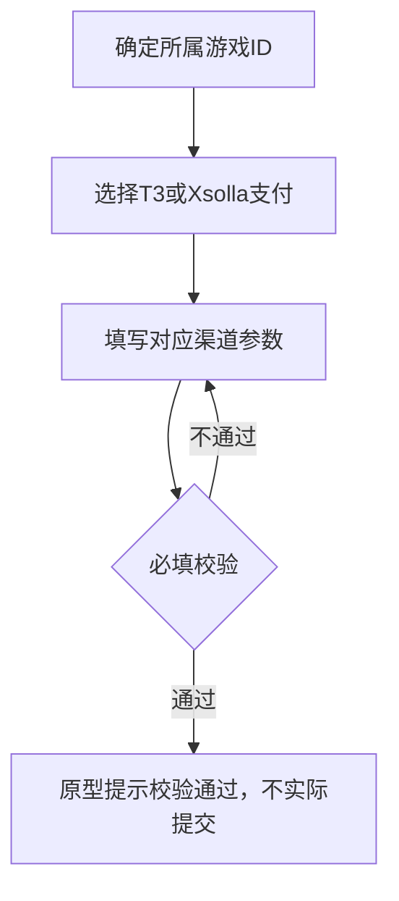

# 支付配置管理原型

本次需求：新增7个三方支付类型——Terminal3（T3）、Razer、Xsolla、Adyen、PayerMax、Waffo、Checkout；原有6种类型保持不变。

## 境内与境外范围

| 区域 | 可选类型 | 三方支付默认兜底 |
|---|---|---|
| 境外 | 原有6种＋新增7种三方支付 | 每游戏、每三方渠道各有一份默认项 |
| 境内 | 仅原有6种类型 | 不存在、不展示、不创建、不读取三方默认项 |

新增7个三方支付类型仅在境外可选；游戏版本优先匹配和三方默认兜底也仅适用于境外。当前静态原型尚未实现区域切换过滤，本节为需求规则。

Status: implemented
Updated: 2026-10-21

## 提示文案（可直接复制）

| 使用位置 | 文案 |
|---|---|
| Terminal3说明 | 从Terminal3管理后台获取 项目的Project Key 和 Secret Key |
| Terminal3公钥问号 | 对应Project Key |
| Terminal3私钥问号 | 对应Secret Key |
| Xsolla说明 | 从Xsolla后台获取到 项目ID、Webhook通知秘钥和API秘钥 |
| Waffo私钥问号 | 需要用支付宝小工具转成PKCS1 （PS：openssl工具生成的就是pkcs1的） |
| Checkout说明 | Webhook通知需要单独配置充值成功通知和退款通知，两个通知的authorizationKey可共用同一个授权密钥，webHookSignKey可共用同一个签名密钥。 |

## 帮助与字段规则

- Waffo 的 merchantId、apiKey、privateKey、publicKey 均提供对应后台脱敏截图；敏感值不得写入源码或图片。
- 所有帮助问号支持鼠标悬停和键盘聚焦；图片提示向下展开、等比例完整显示，桌面不截断，窄屏居中并限制高度。长标签和 Terminal3/Xsolla/Checkout 提示框在窄屏自动换行。
- T3、Xsolla 的 sandBox 默认“否（正式环境）”；七种新增渠道文本参数最大长度99999999字符、格式不限，密钥类字段使用密码输入。

## 默认兜底与版本匹配

## 2026-10-21 本批优化

- 新增 Razer 支付，排序为 Terminal3支付 → Razer支付 → Xsolla支付；Razer 必填游戏版本、`applicationCode` 与密码类型的 `secretKey`，不展示 `gameId`、`sandbox`。
- Checkout 字段顺序调整为 `apiKey`、`processingChannelId`、`authorizationKey`、`webHookSignKey`。
- Checkout 四个字段均展示问号提示，依次对应 API 密钥、处理渠道 ID、授权密钥、Webhook 签名密钥的获取位置截图；提示支持悬停和键盘聚焦。

2026-10-20追加：新增Adyen、PayerMax、Waffo、Checkout，共十二种类型。四个渠道同样必选游戏版本、各游戏各渠道一份默认兜底；gameId不手填，其余截图字段均必填，文本最大99999999字符、格式不限，密钥密码输入。

| 渠道 | 字段名称（键） | 字段限制 | 字段说明 |
|---|---|---|---|
| Adyen | 商户账号（merchantAccount）、API密钥（apiKey）、签名密钥（signKey）、支付方式保存模式（storePaymentMethodMode）、重复支付处理模式（recurringProcessingModel） | 必填，最大99999999字符，格式不限 | 商户识别、API鉴权、签名及支付模式参数 |
| PayerMax | 应用ID（appId）、私钥（privateKey）、公钥（publicKey） | 同上 | 应用识别与渠道密钥 |
| Waffo | 商户ID（merchantId）、API密钥（apiKey）、私钥（privateKey）、公钥（publicKey） | 同上 | 商户识别、API鉴权与渠道密钥 |
| Checkout | API密钥（apiKey）、处理渠道ID（processingChannelId）、授权密钥（authorizationKey）、Webhook签名密钥（webHookSignKey） | 同上 | API鉴权、渠道识别、授权及通知签名参数 |

每个游戏ID各有一份T3默认方案和一份Xsolla默认方案。新增同渠道方案必须选择游戏版本，不自动成为默认兜底。读取顺序：同游戏ID、同渠道范围内优先匹配游戏版本，取不到版本方案则读取该游戏该渠道的默认方案，禁止跨游戏或跨渠道兜底。

列表不展示「兜底」「游戏版本」列；默认方案名称右侧显示「默认」文字标记。当前仅展示演示数据与说明，不执行实际支付匹配。

## 需求与入口

根据用户提供的七张截图，在 SDK 工作台的“配置中心”下增加“支付配置管理”入口。正式页面放在 `admin/config/paymentConfigManagement.html`，由共享 `admin/sidebar.js` 接入；工作台不需要单独修改或重新启动服务。

截图均为“新增支付配置”表单及方案类型下拉状态，本次不增加未提供的支付列表、真实支付接口或生产配置。

## 页面与视觉

- 保留 SDK 现有平台顶栏、共享侧栏和蓝色主色；不复制截图里无关业务菜单及输入法浮窗。
- 白色表单面板、右对齐标签、红色必填标记、400px × 32px 等宽控件、56px 基础行间距。
- 底部操作区包含提交和取消。
- 375px 视口下侧栏默认收起，标签与输入框纵向排布，输入框适应容器宽度，内容可纵向滚动。
- 右下角固定一个 48px 蓝色文档图标，点击后从右侧展开需求说明栏，桌面宽 480px，窄屏适应屏幕宽度。

## 需求说明栏

本次需求说明覆盖十三种支付类型。支付配置按游戏ID维度归属，不同游戏参数隔离，gameId 不作为手填支付参数；说明栏字段表统一使用字段名称、字段限制、字段说明。

| 字段名称 | 字段限制 | 字段说明 |
|---|---|---|
| 游戏ID（gameId） | 配置归属维度，无需手填 | 标识所属游戏；上下文获取方式待确认 |
| 游戏版本 | 必填，下拉单选，默认超能世界-国内 | Terminal3、Razer、Xsolla、Adyen、PayerMax、Waffo、Checkout展示；四个固定游戏版本名称，不展示辅助文案 |
| 方案类型 | 必填，下拉单选 | 新增 Terminal3支付（T3）、Xsolla支付 |
| 方案名称 | 必填，最多100字符 | 标识支付配置方案 |
| 启用状态 | 启用/停用，默认启用 | 标识方案是否启用 |
| T3 公钥（publicKey） | 必填，文本；最大长度99999999字符，格式不限 | Terminal3 Project Key |
| T3 私钥（privateKey） | 必填，密码输入；最大长度99999999字符，格式不限 | Terminal3 Secret Key，支付鉴权凭据 |
| Xsolla 项目ID（projectId） | 必填，文本；最大长度99999999字符，格式不限 | 渠道项目标识，不等同于游戏ID |
| Xsolla API密钥（apiKey） | 必填，密码输入；最大长度99999999字符，格式不限 | API 请求鉴权 |
| Xsolla 通知密钥（notifyKey） | 必填，密码输入；最大长度99999999字符，格式不限 | Webhook 支付通知校验 |
| 沙盒支付（sandBox） | 必选，是/否；默认否 | 两种渠道均适用，true沙盒，false正式 |

同一游戏同一渠道的方案数量、重复配置策略、权限与接口失败处理待确认。静态原型不实现真实游戏归属传递或支付保存接口。

1. 默认关闭；从右下角文档图标打开，内容包含页面范围、基础字段、当前支付类型字段、交互规则及静态原型安全边界。
2. 复用工作台已有说明抽屉的蓝白样式，当前类型字段由表单同一份定义生成，避免说明与页面不同步。
3. 支持右上角关闭、Esc 关闭、点击桌面遮罩关闭；说明内容可独立纵向滚动。
4. 打开时焦点限制在说明栏内，关闭后返回入口按钮；不清空表单草稿、不改变当前方案类型。
5. 页面 CSS、JS 引用使用版本标记，刷新后加载更新资源。

## 字段映射

所有类型共用必填“方案类型”和“方案名称”。默认类型为“支付成功回调地址”。

| 方案类型 | 基础配置 | 渠道凭据字段 | 启用状态 |
|---|---|---|---|
| 支付成功回调地址 | 游戏配置：按区服 / 按Pid；范围输入 | PayCallbackUrl | 不展示 |
| 谷歌支付 | PackageName（包名） | ClientId（应用ID）、ClientSecret（应用密钥）、RefreshToken（刷新Token）、PublicKey（公钥） | 默认启用 |
| 苹果支付 | BundleId（包ID） | IssuerId（发行者ID）、Audience（密钥名称）、AudienceKeyId（密钥标识）、AudiencePrivateKey（私钥）、AudiencePublicKey（公钥） | 默认启用 |
| 华为支付 | PackageName（包名） | ClientId（应用ID）、ClientSecret（应用密钥）、PublicKey（公钥） | 默认启用 |
| 华为快游戏支付 | ApplicationId（应用ID） | ClientSecret（应用密钥）、PublicKey（公钥） | 默认启用 |
| 鸿蒙支付 | ApplicationId（应用ID） | IssuerId（发行者ID）、PrivateKey（私钥）、PrivateKeyId（私钥ID） | 默认启用 |
| Terminal3支付 | 无渠道基础字段 | publicKey（公钥）、privateKey（私钥）、sandBox（沙盒支付） | 默认启用 |
| Xsolla支付 | projectId（项目ID） | apiKey（API密钥）、notifyKey（通知密钥）、sandBox（沙盒支付） | 默认启用 |

Terminal3 与 Xsolla 不配置 `gameId`。公钥、私钥沿用其他支付类型的中文名称；项目ID、API密钥、通知密钥、沙盒支付为新增中文名称。字段键保留截图大小写。`sandBox` 为必选下拉，默认“否（正式环境）”对应 `false`，可切换“是（沙盒环境）”对应 `true`；切换类型保留各自草稿，刷新后恢复默认否。

## 交互与数据边界

1. 方案类型下拉支持搜索、空结果提示、方向键、Enter 选中、Escape 关闭、点击外部关闭。
2. 切换类型时，只在页面内存中保留各类型独立草稿，避免串用不同支付渠道的凭据。
3. 回调范围支持整数及递增区间，例如 `1,2,3,4-5`；回车添加为标签，自动去重，可删除。按区服与按Pid分别保留内存草稿。
4. BundleId 支持回车添加与逗号分隔多个值；拒绝带空格的值，自动去重，可删除。
5. 标签最多 100 项，每项最多 200 个字符；整数范围不展开为完整列表，避免大范围输入导致浏览器卡顿。
6. 提交检查必填字段、范围及 HTTP/HTTPS 回调地址，错误显示在字段下方并定位到首个错误项。
7. 校验通过只提示“当前为静态原型，未提交到支付服务”，不发送网络提交请求。
8. 取消返回配置中心。密钥、Token 不写入本地存储、日志或文件；敏感输入使用密码控件。刷新后表单恢复初始状态。

## 验证

`.tests/2026-10/2026-10-20/payment-config-management.test.cjs` 验证工作台入口、八类字段、400px 等宽、单行标签、搜索与键盘、必填与 URL 校验、标签添加/删除、草稿隔离、启用开关及取消；新增类型同时检查无 gameId 控件、沙盒必选与 false 草稿恢复、密钥密码控件和需求说明同步。

使用已安装的 Playwright 和 Chrome，检查 1920×919、1440×900、375×667；截图保存在仓库根 `.temp/sdk-payment-config-2026-10-20/`。本次不安装依赖，不创建新服务或改动其他系统。
