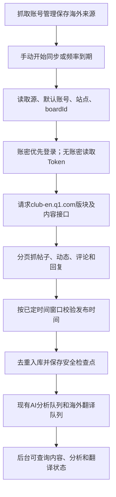

# 海外 BigPlayer API 采集器重写

## 1. 需求概述

用户要求：重写海外 BigPlayer 数据抓取，方案与国内基本一致；实际 API 请求前缀为 `https://club-en.q1.com`，帖子、动态、评论使用与国内相同的接口路径。

适用范围为所有 `regionCode=overseas`、`platform=bigplayer_h5` 的已配置采集源，不限定单个 Last Night 来源。目标是复用国内经过验证的配置读取、授权、分页、手动/定时执行、入库和 AI 分析流程。保留现有后台操作入口、原文与中文翻译能力。国内采集器和其他平台不在本需求修改范围。

用户已明确域名、接口与复用方向，并于2026-10-09通过Codex会话弹窗选择“沿用国内现行窗口和游标规则”。本文件为需求定稿，不是代码完成、真实采集成功或部署成功的证明。

## 2. 数据流程

## 3. 配置及接口字段

### 3.1 列表与运行记录

| 字段 | 口径 |
|---|---|
| 地区、社区、来源 | 使用后台保存的地区、`communityId`、`sourceId`，不能用接口 `boardId` 反推社区 |
| 授权与能力状态 | 展示实际检查结果；授权成功不能替代内容接口可用性验证 |
| 同步状态与计数 | 沿用现有字段；抓取、入库、评论正文、AI完成分别反映真实进展 |
| 异常与部分完成 | 标识失败站点/分页/评论阶段，不用空结果或动画冒充成功 |

### 3.2 现有表单配置

| 字段 | 类型 / 要求 | 默认或来源 |
|---|---|---|
| 地区 / 平台 | `overseas` / `bigplayer_h5` | 当前上下文 |
| 社区 / 来源 | 既有游戏、社区、来源身份 | 抓取账号管理 |
| 站点地址 | 一行一个链接；读取所有启用地址，保留游戏、版本、语言等有效参数 | 已保存配置 |
| API origin | `https://club-en.q1.com` | 用户指定；所有本次海外API请求使用此origin |
| `boardId` | 正整数、必填；校验账号可访问的对应版块 | 当前来源配置；不臆造其他社区默认值 |
| 采集频率 | 1小时 / 6小时 / 1天 | 默认6小时；已有选择保留 |
| 账密 / Token | 有账密优先取登录结果，没有账密才用已保存Token | 当前来源的默认账号；敏感值不入文档或日志 |
| 启用状态 | 源、社区、游戏、账号均需有效 | 已保存配置 |

### 3.3 核心接口

| 对象 | 方法与路径 | 请求origin |
|---|---|---|
| 帖子 | `GET /api/club/v1/auth/post/list` | `https://club-en.q1.com` |
| 动态 | `GET /api/club/v1/auth/post/activity/list` | 同上 |
| 评论、回复 | `GET /api/club/v1/auth/comment/{postId}`，回复参数沿用国内契约 | 同上 |

版块发现、正文详情补全等辅助请求复用国内已有接口契约，origin也使用海外地址；不能只改三个列表请求而遗留国内辅助请求。Swagger用于确定接口契约，实际内容读取来自上述API。`boardId`、`sectionId`、分页游标与必要上下文参数沿用国内契约，不混淆列表查询参数 `type` 与内容原始 `type`。

## 4. 功能逻辑

1. 配置保存后由既有任务体系读取来源，支持手动开始同步与采集频率触发，两种入口执行同一套采集逻辑。不写死sourceId、社区、版块或站点数量。
2. 多链接逐站点执行并记录站点结果。合法配置必须能保存、重载并进入执行；任一站点失败不能掩盖其余结果或把父任务报为全量成功。
3. 海外使用对应来源账号的海外登录态。账密登录失败明确返回原因，不静默回退旧Token；Token被拒绝时沿用现有有限刷新/重新授权流程。
4. 在账号可访问范围内，按配置版块发现栏目，抓取帖子、动态及评论回复；分类型按国内原始内容契约保留字段，帖子展示标题与正文，动态展示正文。
5. 分页、窗口、站点和任务检查点按国内基准复用；只有完成分页或验证时间边界后才可宣称对应范围完成。达到上游硬上限、分页停止推进或部分阶段失败应可定位、可继续处理。
6. 每页真实入库后计数增加；重复同步不重复入库，不重复产生同一内容版本的AI/翻译任务。入库后走现有异步AI分析、海外翻译与后台查询链路。
7. 评论完整性按正文记录及父子关系验收，不以列表里的`commentCount`替代。特别核查已入库未变化帖子有新增评论，以及窗口内评论挂在较早帖子下的场景；如国内基准也存在覆盖缺口，报告为缺陷，不将跳过评论当作符合需求。
8. 常驻与本机恢复沿用国内既有运行体系；新旧海外入口只能有一个实际执行者，重启恢复后不得重复抢同一任务。运行接线由项目经理安排开发负责人实施、测试负责人验证。

### 已弹窗拍板：采集时间范围

- 沿用国内现行窗口与游标。统一调度02:00槽从前一天北京时间00:00起、结束扩至排程执行时刻；其他槽从排程时刻前7天至执行时刻，已完成站点游标可收窄起点；手动增量按数据库准入时刻与完成游标确定最近7天内窗口。沿用半开区间`[start,end)`。
- 用户此次选择替代本需求范围内早期“每次固定昨天00:00到现在”的时间口径；国内现行逻辑不因本需求改变。

拍板来源：本会话2026-10-09的弹窗回复“沿用国内现行窗口和游标规则（推荐，符合本次仅更换域名的要求）”。无待定产品选项，进入项目经理评审与开发交接。

## 5. 边界与验收

| 前置条件 → 操作 | 预期结果 |
|---|---|
| 单个海外源配置有效 → 手动开始同步 | 真任务领取；实际请求origin为club-en；帖子、动态、评论正文入库，随后AI/翻译入队 |
| 配置N个启用链接 → 执行采集 | N个站点全部有执行结果；不限定三站点，不只取第一条 |
| 账密有效 / 仅Token有效 → 分别执行 | 两种授权模式分别成功；账号、站点、版块归属正确 |
| 账密失败 / Token失效 / 版块无权访问 | 明确授权或权限失败，无跨来源Token复用，不把失败显示为零内容成功 |
| 有帖子、动态、评论、二级回复 → 抓取并在后台筛选 | 类型、原文、图片、发布时间、父子关联、来源与语言正确；评论数量与实际正文对账 |
| 同一窗口重复执行 / 手动与定时同时触发 | 去重、任务并发控制及检查点有效，不重复入库或重复AI计数 |
| 上游确实没有数据 / 网络失败 / 分页硬上限 | 分别表示空结果、失败、部分完成，不混同 |
| 1小时 / 6小时 / 1天 → 到下个实际槽位 | 自动创建、领取、发起请求、入库并记录终态；需真实下一槽位证据，不能仅凭单测称稳定 |
| 重启电脑 → 使用既有本机恢复skill | 恢复海外执行所需常驻worker；任务可继续，无重复消费者 |
| 国内及Discord/TapTap/Facebook回归 | 既有来源配置、请求origin、调度和结果保持正确 |

现状风险（只读代码/历史文档证据）：现有`BigPlayerH5Connector`已允许国内及海外域名；海外还存在针对单来源固定三站点的专用入口，以及历史配置/站点registry不一致、缺少boardId等记录。开发须核实当前有效运行版本与真实配置，不把历史阻塞当作仍然发生的事实；不直接删除历史数据或未经评估重键。

## 6. 交接范围

- 产品经理交付本需求和验收口径；项目经理负责评审、安排开发/测试及运行切换。
- 相关代码：`server/src/connectors/bigPlayerH5Connector.js`、`server/src/services/sourceValidators.js`、`server/src/services/bigplayerSiteConfig.js`、`server/src/app.js`、`server/src/db/repository.js`、`worker/src/worker.js`、`worker/src/sourceScheduler.js`、`worker/src/schedulerRepositoryAdapter.js`、`worker/src/lastNightOverseasDailyJob.js`及相应测试。
- 历史参考：`.Codex/docs/2026-10/2026-10-08/v014_overseas_bigplayer_identity_changelog.md`、`v020_lastnight_overseas_scheduler_candidate_changelog.md`；不是恢复所有历史任务的授权。
- 交付要求：本地代码验证、独立回归、对应海外源真实手动采集与下一定时槽位证据分别报告。单元测试通过或授权检测通过不等于真实抓取成功。
- 本需求未要求删历史数据或推送git；如实现确需结构迁移、停服或配置数据修复，先由项目经理说明具体影响并按现有岗位流程办理。
